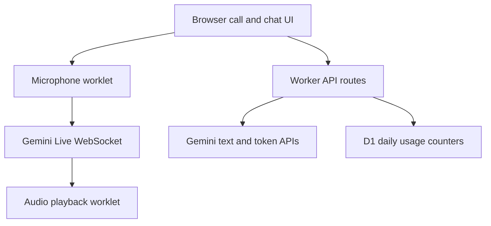

# Friendly Voice Agents — case study

[Open the live app](https://friendly-voice-agents.achida.chatgpt.site)

Friendly Voice Agents is a responsive browser app for live voice conversations and text chat with named AI agents. It was developed by **Sylvanus, a software engineer from Ghana**. Gemini supplies the AI models and Live API; the app and user experience were built for this project.

## The problem

An AI call needs to feel immediate on a phone: a clear start and mute flow, visible listening and speaking states, a separate text chat, and file attachments that work without crowding the call screen. Microphone capture by itself is not enough; the session must also send correctly encoded audio and play the model's reply.

## What I built

- A mobile-friendly call interface with agent selection, mute, speaker controls, call timer, and a separate text composer.
- Live microphone capture through a browser audio worklet. It resamples the device rate to 16 kHz PCM and sends audio to Gemini Live over a WebSocket.
- Audio playback at the model output rate through a second worklet, plus transcription and interruption handling.
- Text chat with images, PDFs, DOCX, text, audio, and short video attachments; validation and size limits run on the server.
- Incognito controls for app-side conversation memory and a local memory option for regular sessions.
- A server token route that uses a Gemini API key kept in the runtime, and a daily usage counter backed by D1.

## Architecture

The voice flow uses a short-lived token returned by `/api/token`. The text and attachment flow uses `/api/chat`. The runtime secret stays on the server. The current production Worker embeds its browser assets in `index.js`; its API logic lives in `api-handlers.js` in the private source repository.

## Engineering notes

The microphone worklet must remain connected to the audio graph on mobile browsers. It outputs silence while capture continues, avoiding microphone feedback. Device audio rates vary, so the worklet resamples before sending 16 kHz PCM. A call starts from a user tap so the browser can grant microphone and playback access. On reconnect, the app checks the active microphone and resumes playback when the page becomes visible.

The browser's sleep and background rules still vary by platform. A wake lock can help while the page is active; it cannot guarantee a continuous call after every phone locks. The app also has daily limits and file validation to bound API use.

## Stack

JavaScript, HTML/CSS, Web Audio API, Gemini Live API, Gemini text generation API, a Worker runtime, and D1. The deployment is hosted with ChatGPT Sites.

## Project links

- [Live application](https://friendly-voice-agents.achida.chatgpt.site)
- [Private production source](https://github.com/Achidaq/Voice-agent) (access required)

This public repository documents the project. It does not contain runtime credentials, recordings, or the full private application source.
